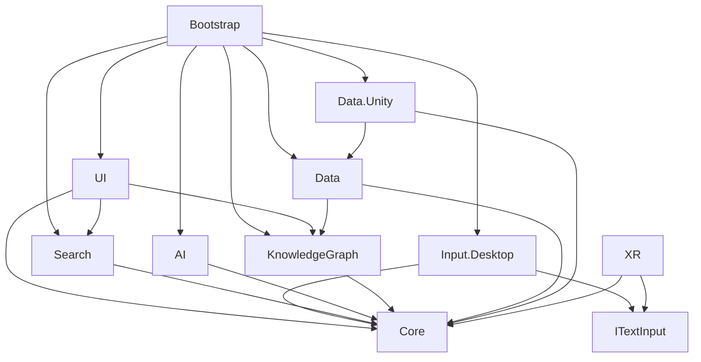

# Архітектура Synaps

## Межі й напрямок залежностей

`Core`, `Search`, `KnowledgeGraph`, `AI`, `Input` і `Data` — звичайний C# без `UnityEngine`.
`Data.Unity`, `UI`, `Input.Desktop`, `Bootstrap` — платформні адаптери.
Коло залежностей відсутнє. Усі concrete-залежності обирає `SynapsBootstrap`; доменні сервіси отримують їх
через конструктори. Глобального service locator та singleton для графа немає.

| Модуль | Відповідальність | Чому тут |
|---|---|---|
| Core | SearchResult, KnowledgeNode, KnowledgeEdge, GraphDocument, SpatialPosition, SuggestedEdge, IWorkspaceInteraction | Спільні типи не повинні залежати від камери або SDK |
| Search | ISearchProvider, MockSearchProvider, SearchController, SearchState | Провайдер можна замінити без зміни графа та інтерфейсу |
| KnowledgeGraph | Команди графа, цілісність даних, workspace-selection, IGraphRepository | Семантика графа однакова для мишки й рук |
| AI | IAIService та MockAIService | Модель/API не визначають структуру продукту |
| Input | ITextInput і desktop-адаптери | Спосіб вводу змінюється незалежно від пошуку |
| Data | Файловий репозиторій, IGraphSerializer | Збереження — зовнішній порт, а не частина UI |
| UI | Картки, вузли, стрілки, відображення стану | Візуальне представлення не володіє даними графа |
| XR | Майбутні адаптери SDK | Перший етап не потребує VR-пакетів |
| Bootstrap | Створення й життєвий цикл desktop-застосунку | Вибір конкретних реалізацій зосереджено в одному місці |

## Дані

- `SearchResult`: Id, Title, Url, Snippet, Source, Type. Провайдер має повертати стабільний унікальний ID.
- `KnowledgeNode`: Id, SearchResultId, Title, Content, Summary, SourceUrl, NodeType, Position,
  CreatedAtUtcTicks, UpdatedAtUtcTicks.
- `KnowledgeEdge`: Id, FromNodeId, ToNodeId, RelationType. Зв’язки спрямовані, тип зберігається як нормалізований рядок.
- `GraphDocument`: SchemaVersion, Nodes, Edges. Поточна версія схеми — 1.
- `SpatialPosition`: X/Y/Z у метрах відносно workspace. Немає залежності від Unity Vector3 або світової позиції шолома.

Публічні поля DTO потрібні для стандартного Unity JSON. Сервіс не віддає власні DTO:
`Snapshot`, `FindNode`, повернення команд і стан пошуку створюють копії. View не може обійти команди, змінюючи об’єкт.
Desktop-view відображає X/Y на world-space Canvas з коефіцієнтом 100 UI-одиниць/метр;
позиція Z зберігається, але прототип не має повноцінного 3D spatial layout.

## Пошук і асинхронність

`ITextInput.Submitted → SearchController.SearchAsync → ISearchProvider → SearchState → DesktopWorkspaceView`.

Новий запит скасовує попередній. Номер запиту додатково відкидає застарілу відповідь,
навіть коли зовнішній провайдер ігнорує cancellation. Порожній запит очищає результати.
Стани: Idle, Searching, Succeeded, Failed, Cancelled. Помилка не блокує наступний пошук.
Під час знищення composition root запити скасовуються й відписуються обробники подій.

Контролери й граф використовуються на одному контексті — main thread Unity. `await` у контролері
зберігає контекст виклику. Внутрішній HTTP-адаптер може працювати асинхронно, але не має викликати
Unity API у фоновому потоці або самостійно змінювати graph/UI.

## Граф і взаємодія

`SaveSearchResult` перетворює результат на вузол і дедуплікує за `SearchResultId`.
Повторне Save не пересуває існуючий вузол. `MoveNode` приймає лише скінченні координати.
`Connect` перевіряє існування обох кінців, забороняє self-edge та дедуплікує той самий спрямований тип зв’язку.
`RemoveNode` прибирає також усі зв’язки цього вузла. `GetNeighbours` повертає унікальних сусідів в обох напрямках.

`WorkspaceController` володіє тимчасовим вибором та режимом Connect; вони не записуються у файл.
Desktop-адаптер лише переводить pointer-події в `IWorkspaceInteraction`.
`GraphPresenter` оновлює існуючі view, тому перетягування не знищує активний вузол.
Граф наразі показує всі вузли; режим «поточний вузол + сусіди», масштабування й 3D-розкладка — наступні UI-ітерації.

## Збереження

`KnowledgeGraphService` працює через `IGraphRepository`; `FileGraphRepository` не залежить від Unity.
`IGraphSerializer` дозволяє перевіряти файлову поведінку поза рушієм;
реальна desktop-сцена використовує `UnityJsonGraphSerializer`.

Валідація застосовується після читання й перед записом: версія схеми, колекції, унікальні ID,
типи вузлів, скінченні позиції, існування кінців і відсутність дубльованих/self-зв’язків.
Невідома версія схеми блокує завантаження, щоб майбутній формат не був тихо замінений старим.
На пошкоджений файл поширюється відновлення з `.bak`; помилки доступу до файла показуються напряму.

Сервіс позначає зміни через `IsDirty`. Bootstrap виконує debounce-запис через 0,6 секунди,
а також записує при Pause, Quit і знищенні об’єкта. Невдалий запис лишає граф dirty та повторюється через 5 секунд.
Невдале початкове завантаження блокує редагування, щоб не затерти дані порожнім документом.

Файлові операції синхронні й розраховані на невеликий прототип. Великий граф потребуватиме іншого репозиторію
або фонового запису snapshots. Атомарну заміну файла треба перевірити на цільовій Quest/Android-платформі;
якщо вона не підтримана, помилка залишається видимою й поточний файл не видаляється.

## AI

`IAIService` визначає SummarizeAsync, ExtractConceptsAsync, SuggestConnectionsAsync.
`MockAIService` тільки скорочує текст із позначкою `[Mock summary]`; концепти та suggested edges повертаються порожніми.
Прототип не вигадує семантичні зв’язки. UI оновлює summary лише для поточної ревізії результатів.
Запропоновані реальним AI зв’язки мають проходити підтвердження користувачем та ті самі graph-команди.

## Як додавати справжні реалізації

1. Реальний пошук: реалізуй `ISearchProvider`, інжектуй його замість `MockSearchProvider`.
   Додай HTTP timeout, cancellation, мапінг перевірених URL та стабільні ID.
2. Реальний AI: реалізуй `IAIService` через власний backend, заміни фабрику в composition root.
   API-ключі тримай на сервері, а не в Assets, APK або налаштуваннях player.
3. XR: додай SDK лише в XR assembly, реалізуй `ITextInput`, транслюй select/grab у `IWorkspaceInteraction`.
   Створи XR composition root та rig, використовуй ті самі graph/search/AI/data сервіси.
4. Власний experimental text input: незалежний декодер подає текст через `ITextInput.TextChanged` і `Submitted`.
5. Дизайн: перенеси runtime-фабрики у prefabs, залишивши view-команди й інжекцію сервісів.

На цьому етапі не реалізовано live-search, справжній AI, hand tracking, XR rig, probabilistic decoder,
кластеризацію, embeddings чи cloud sync. Це точки розширення для наступних ітерацій.
